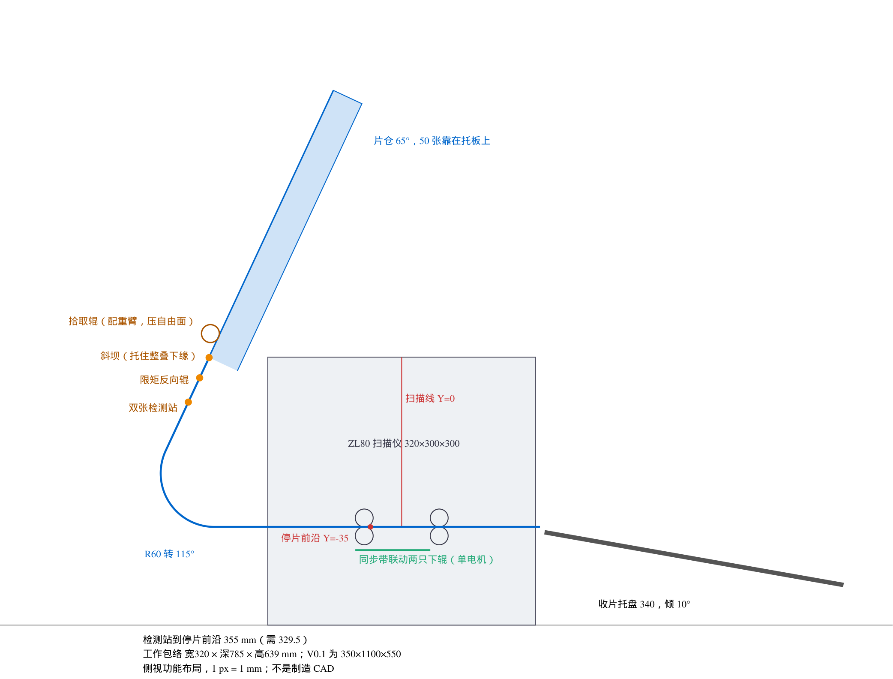

# ZL80 ADF50 V0.2：对 V0.1 的评估与重新设计

2026-11-16｜初步设计，不是制造放行。全部数字来自假设输入的计算和名义外形模型，没有实物试验。V0.1 文件夹保持原样。

## 1 结论

V0.1 的目标、安全逻辑和批次账本是对的，V0.2 全部沿用。V0.2 改了四处：

1. **拾取面换到片堆的自由面**。片堆靠在托板上，拾取辊用配重臂压上面那一张。拾取界面的压力不再随片数变化，V0.1 自己指出的"厚片满仓压力超限"不再出现。
2. **用斜坝代替托趾加剥离靴**。整叠下缘靠在一道斜坝上，只有被拾取辊推动的那一张能爬过去。这是被动件，没有需要时序配合的剥离动作。
3. **路径向上折回到扫描仪上方**。占地从 0.385 m² 降到 0.251 m²（减 35%），进深从 1100 mm 降到 785 mm，高度从 550 mm 增到 639 mm。
4. **扫描段两只下辊用一台电机加同步带联动**，取代 V0.1 的双电机主从切换。

另外，节拍按 R5.2 的三档扫描模式重算。高黑度档 50 张要 4.6 到 18 小时，这一点 V0.1 没有反映。

## 2 对 V0.1 的评估

| 项目 | V0.1 的做法 | 评估 |
|---|---|---|
| 完成标准、重试上限、断电恢复、文件与实物分别计数 | 状态机和账本 | 保留。control 目录原样沿用。 |
| 整张通过双张检测后才扫描 | 355 mm 直线缓冲 | 原则保留。直线缓冲是进深 1100 mm 的主因，改为折叠路径。 |
| 馈片与计量解耦、扫描前全部释放 | 抬起、离合、位置确认 | 保留。 |
| 除静电、气流与 PMT 隔离 | 两处离子化，扫描前静默 | 保留。 |
| 片仓 80°，片堆压向拾取辊，后面加随动压板 | 界面压力 = 片堆法向分力 + 压板力 | 有缺陷。50 张 0.35 mm 片的自然法向力 1.00 N 已超过 0.9 N 目标，V0.1 自己标为不可行。压力从满仓到末张要靠测力闭环补偿。 |
| 托趾 + 前张局部抬起 1–3 mm 越过托边 | 主动剥离，待透明样机验证 | 是 V0.1 最大的未验证机构，且要求"两道支撑不得同时撤走"的时序。 |
| 入口、出口各一台电机，中段切换主从 | 两段编码器接续 | 能解决首尾 42 mm 无驱动的问题，但引入双电机对顶和坐标接续风险。 |
| 节拍按 15 / 5 / 1.5 mm/s | 50 张 26 到 226 分钟 | 与 R5.2 预算不符。R5.2 的高黑度档走片 0.23 或 0.94 mm/s。 |
| 工作包络 350×1100×550 | 直线展开 | 与主设计里预留的外置馈片位（250×300×330）差距很大。 |

## 3 V0.2 方案

### 3.1 片仓和拾取

片仓与水平面成 65°，向扫描仪上方倾斜。50 张片靠在托板上，下缘落在斜坝上。拾取辊装在配重臂上，从上方（操作者一侧）压住最上面一张，装片也从这一侧放入。

| 量（0.20 mm 片，50 张） | V0.1 | V0.2 |
|---|---|---|
| 拾取界面压力，满仓 | 0.90 N（其中片堆自重 0.57 N） | 1.03 N（配重臂 1.0 N） |
| 拾取界面压力，末张 | 0.90 N（压板要补到 0.89 N） | 1.03 N |
| 需要测力闭环或随动压板 | 需要 | 不需要 |
| 0.35 mm 片满仓 | 自然法向力 1.00 N，超出目标 | 2.05 N，由配重配方设定 |

片堆的重量由托板（法向 1.4 N）和斜坝（沿坡 3.0 N）承担，不经过拾取界面。

### 3.2 斜坝分片

片的下缘顶在斜坝上。要越过 2.5 mm 高的坝，片缘必须被顶起，这需要沿片面方向有足够的推力。最上面一张有拾取辊推；第二张上下两面的摩擦力基本抵消，只剩自重和粘附力。

| 片厚 mm | 坝角 | 配重臂力 N | 越坝所需推力 N | 顶张可用推力 N | 余量倍数 | 自重推力占所需 | 第二张允许的粘附力 N |
|---|---|---|---|---|---|---|---|
| 0.15 | 65° | 0.6 | 0.30 | 0.47 | 1.6 | 15% | 0.25 |
| 0.20 | 60° | 1.0 | 0.43 | 0.76 | 1.8 | 14% | 0.37 |
| 0.35 | 45° | 2.0 | 1.02 | 1.51 | 1.5 | 10% | 0.92 |

坝角和配重随片厚换配方，所以仍然是一批一个厚度等级。假设：辊对片摩擦系数 1.0，片间和片对坝 0.3，弹性模量 4 GPa，拾取点到坝 25 mm。这是悬臂梁估算，必须用透明样机和真实底片确认。

斜坝之后保留限矩反向辊作第二道防线。它的力窗口比 V0.1 宽，因为压力不随片数漂移：

| 片厚 mm | 反向力窗口 N | 窗口宽度 N | V0.1 窗口 |
|---|---|---|---|
| 0.15 | 0.27–0.54 | 0.27 | — |
| 0.20 | 0.41–0.96 | 0.55 | 0.32–0.77（宽 0.45） |
| 0.35 | 0.75–2.00 | 1.25 | — |

### 3.3 折叠路径

片从片仓沿 65° 下行，经过斜坝、反向辊、双张检测站，然后以 R60 转 115°，水平进入扫描仪前面板。

| 项目 | 数值 |
|---|---|
| 双张检测站到停片前沿 | 355 mm（需要 329.5 mm，余 25.9 mm，与 V0.1 相同） |
| 其中：斜段 / 弧段 / 水平段 | 60 / 120 / 175 mm |
| 弯曲应变（0.20 / 0.35 mm 片） | 0.17% / 0.29%，与 V0.1 的 R60 相同 |
| 片仓托板到扫描仪顶前角 | 19 mm |
| 片仓伸到扫描仪上方 | 74 mm |
| 向扫描仪前方伸出 | 140 mm |

| 包络 | V0.1 | V0.2 |
|---|---|---|
| 宽 × 深 × 高 mm | 350 × 1100 × 550 | 320 × 785 × 639 |
| 占地 m² | 0.385 | 0.251 |
| 体积 m³ | 0.212 | 0.160 |

收片仍用 340 mm 长的托盘，放在扫描仪后方，向下倾 10°。进深里有 345 mm 是它。把收片折到机顶可以再省约 300 mm，但扫描时片头要被推上弯道，会给计量段加负载，这一版不做。

### 3.4 扫描段驱动

入口和出口两只下辊用同步带 1:1 联动，由一台电机驱动。片头进入扫描线时由入口辊驱动，片尾离开时由出口辊驱动，中间不需要切换。两端编码器保留。

这是对 G3 四辊包的改动（G3 现为出口单驱动、入口随动）。两只辊的直径要配磨，否则片在两辊之间会被拉紧或起拱。

### 3.5 节拍

只有 300 mm 成像段按扫描速度走，前导 35 mm 和尾部 65 mm 按 15 mm/s 快走，每张另加 5 秒辅助时间。

| 模式 | 行平均 | 走片 mm/s | 覆盖密度 | 每张 | 50 张 | 8 小时可扫 |
|---|---|---|---|---|---|---|
| 快速 | 1 | 15 | 约 D 2.5 | 0.5 分钟 | 0.4 小时 | 909 张 |
| 标准 | 8 | 1.9 | D 3.5 | 2.9 分钟 | 2.4 小时 | 167 张 |
| 高黑度（PMT 增益 1000，待滨松确认） | 16 | 0.94 | D 4.5 | 5.5 分钟 | 4.6 小时 | 86 张 |
| 高黑度（PMT 增益 5000） | 64 | 0.23 | D 4.5 | 21.5 分钟 | 17.9 小时 | 22 张 |

高黑度档下，50 张一批要跑一个夜班甚至更久。这时一次双张或卡片会让整批停在半夜，所以高黑度批次更依赖 V0.1 的"暂停并保留账本"逻辑，也更值得做"预扫定档"：先用快速档过一遍，按每张的最大密度决定用哪一档。预扫需要片能退回缓冲段，这一版只列为待评估项。

## 4 外形干涉

V0.2 的五块外形体（转弯罩、分片头、片仓、对接导槽、收片托盘）放进 R5 整机坐标，与 R5 全部 149 个实例对查。主设计里原有的外置馈片占位 A01 和两只手动托盘 A02 由本模块取代，不参与对查。

结果：0 处干涉。文件 `cad/ADF50_V02_envelope.step`，结果 `tests/envelope_interference.json`。

这只说明外形占位不与扫描仪相碰。机构零件、紧固、线束、开盖空间都没有建模。片仓压在扫描仪顶盖前部上方 74 mm，开顶盖维护时要先卸下或翻开片仓。

## 5 仍未关闭

| 编号 | 风险 | 关闭方式 |
|---|---|---|
| V2-R01 | 斜坝估算不成立：顶张爬不过，或第二张跟着爬 | 透明样机，三种片厚，50/25/1 张，坝角和坝高可调 |
| V2-R02 | 配重臂压力划伤影像面（0.35 mm 片要 2 N） | 真实底片两面，新辊和老化辊，斜光显微 |
| V2-R03 | 片堆靠在托板上起拱或下滑 | 60°–70° 试角度，翘曲片 |
| V2-R04 | 115° 弯道里推片卡滞，尤其厚片和卷曲片 | 弯道样机，导向净隙和辊距 |
| V2-R05 | 同步带联动的两辊直径不一致，片被拉紧或起拱 | 配磨后用标定靶测首、中、尾坐标 |
| V2-R06 | 片仓挡住扫描仪顶盖维护 | 铰接或快卸，结构设计时定 |
| V2-R07 | 高黑度批次耗时 5–18 小时 | 取决于 PMT 低增益能否确认；评估预扫定档 |
| 沿用 | 静电、双张漏检、胶料污染、气源与臭氧、B10 电路、50 张批次可靠性 | 见 V0.1 的 risks_and_gates.csv，全部仍然开放 |

## 6 文件

| 文件 | 内容 |
|---|---|
| engineering/parameters.json、calculate.py、calculated_results.json | 输入、计算、结果 |
| engineering/V01_V02_对比.csv | 两版逐项对比 |
| engineering/分片配方.csv | 三种片厚的坝角、配重和力窗口 |
| engineering/节拍.csv | 四种模式的批次时间 |
| engineering/risks_and_gates.csv | 新增风险 V2-R01 至 V2-R07 |
| engineering/draw_layout.py、docs/ADF50_V02_布局.svg/.png | 侧视布局 |
| cad/build_envelope.py、cad/ADF50_V02_envelope.step | 外形体和干涉检查 |
| control/ | 自 V0.1 原样复制的状态表和参考状态机 |
| tests/test_adf50_v02.py | 计算和几何的回归测试 |
