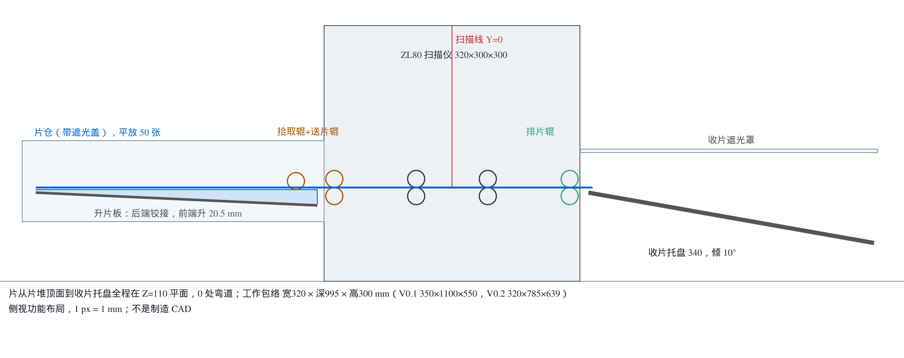
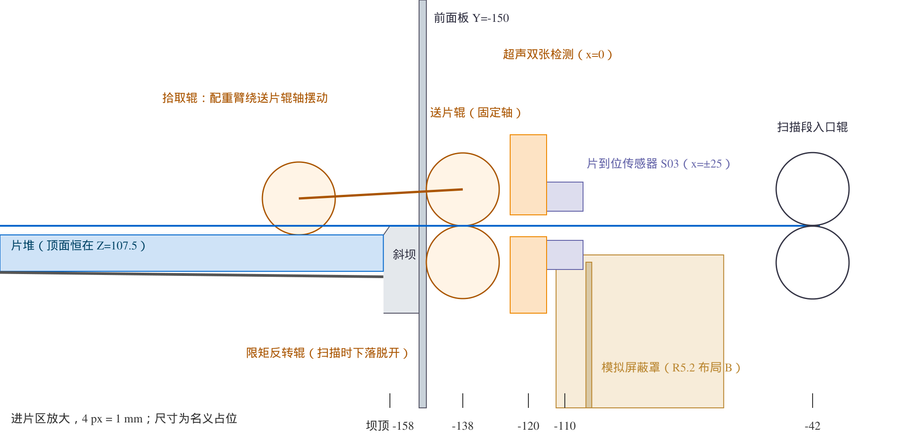

# ZL80 ADF50 V0.3：同平面直通进片，并入 ZL80 本体

修订 ADF50-V0.3-PDR，2026-11-16。初步设计：只有计算和名义外形占位，没有样机和实测，不是制造放行。V0.1、V0.2 两个文件夹保持原样。

## 1 结论

- V0.2 把片仓折到扫描仪上方、经 R60 转 115° 进片，这个方案撤回。原因见第 2 节。
- V0.3 改为同平面直通：片仓平放在扫描仪前方，片从片堆顶面到收片托盘全程在 Z=110 平面，没有任何弯道。
- 自动馈片不再是外挂模块。分离辊组装进扫描仪前面板，排片辊组装进后面板，取代原来的两个迷宫；片仓和收片托盘只是挂在面板上的钣金件。
- 同一条通道也走长片：抬起拾取臂、落下反转辊，就是一条直通缝，长片或连续片照 R5 的方式手动送入。
- 代价是长度：整机 320×995×300 mm，比 V0.2 长 210 mm，但不加高，体积是四个方案里最小的。它适合顺着工作台横放，操作者面对长边。

## 2 V0.2 为什么不合理

| 问题 | 说明 |
|---|---|
| 弯道拖着片尾扫描 | 300 mm 的片在扫描时后半段还在 R60 弯道里，弯道摩擦直接变成扫描段的速度扰动。 |
| 双面乳剂被导板摩擦 | 工业底片两面都有乳剂，115° 的导向弯道两面都要贴导板滑行。 |
| 厚片过弯靠推 | 0.35 mm 片弯曲刚度是 0.20 mm 片的 5 倍多，靠 25 mm 外的辊推过弯道，卡滞风险高。 |
| 片仓压在顶盖上方 | 开盖维护光学件要先拆片仓，机器加高 339 mm。 |
| 与长片通道不兼容 | 走长片时整个弯道模块要卸掉。 |
| 结构上还是外挂 | 独立机架、独立对接导向，与扫描仪的片面基准靠装配保证。 |

V0.1 同样有一段 R60 弯道（片仓 80°），并且靠一段 355 mm 的缓冲通道隔离，所以长到 1100 mm。

## 3 架构对比与选择

| 方案 | 包络 宽×深×高 mm | 占地 m² | 体积 m³ | 导向弯道 | 对扫描仪本体的改动 | 长片同通道 |
|---|---|---|---|---|---|---|
| A　V0.1 外置，片仓 80°，整张缓冲 | 350×1100×550 | 0.385 | 0.212 | 100° | 无 | 否 |
| B　V0.2 片仓折到扫描仪上方 | 320×785×639 | 0.251 | 0.161 | 115° | 无 | 否 |
| C　整机倾斜 60° 直通（估算） | 320×653×658 | 0.209 | 0.138 | 0 | 光学核心整体旋转，新机架和机箱 | 否 |
| D　V0.3 同平面直通 | 320×995×300 | 0.318 | 0.096 | 0 | 前后面板开口，迷宫换成辊组 | 是 |

选 D。理由：

- 直通方案只有 C 和 D。C 是商用片式数字化仪常见的布局，占地最小，但要把激光器、多面镜、f-θ 镜和收光筒整体转 60°，机架、机箱、散热和多面镜电机姿态都要重做，R5 已有的干涉检查和图册全部作废。
- ZL80 的定位是连续片扫描仪。D 的通道水平、两端敞开，长片可以直接走；C 的长片要从高处垂下来。
- D 对光学核心零改动，改动集中在前后面板和进片辊组。

C 作为备选保留：如果工作台放不下 1 m 长的机器，再评估 C。表中 C 的尺寸是按几何关系粗估的，没有建模。

## 4 V0.3 设计

### 4.1 片的路线（Y 坐标，mm）

| 位置 | Y | 说明 |
|---|---|---|
| 片仓后端 | −500 | 后挡板可调，适应片长 |
| 拾取辊接触点 | −183 | 压在片堆顶面 |
| 斜坝顶 | −158 | 片堆前缘靠坝定位 |
| 前面板 | −150 | 开口 140×70 |
| 送片辊 / 限矩反转辊 | −138 | 机内，取代入口迷宫 |
| 超声双张检测 | −120 | x=0，上下对射 |
| 片到位传感器 S03 | −110 | 沿用，x=±25 |
| 扫描段入口辊 | −42 | 沿用 |
| 扫描线 | 0 | — |
| 扫描段出口辊 | +42 | 沿用 |
| 出口传感器 S03 | +110 | 沿用 |
| 排片辊 | +138 | 机内，取代出口迷宫 |
| 后面板 | +150 | 开口 140×70 |
| 收片托盘末端 | +495 | 托盘 340 mm，下倾 10° |

无支撑的最长跨距是送片辊到扫描入口辊的 96 mm，中间由现有导条和上下导板托住。

### 4.2 取片和分离

- **顶面取片。** 片堆平放在升片板上，拾取辊装在配重臂上，靠自重压最上面一张。拾取压力只由配重决定，满仓和最后一张相同。
- **升片板保持顶面高度。** 升片板后端铰接，前端由小电机顶起，拾取臂上的位置挡片做反馈，使片堆顶面始终在 Z=107.5。行程 20.5 mm，满仓时前端举升力约 2–3.6 N。升片只在两张片之间动作。
- **斜坝预分离。** 坝高 2.5 mm，只有被拾取辊推动的顶张能爬上去。按悬臂梁估算，顶张推力余量 1.8–1.9 倍；顶面高度偏差 0.5 mm 时仍有 1.5 倍。
- **送片辊加限矩反转辊做主分离。** 送片辊固定轴在片面上方，拾取臂绕它摆动，两辊由同一电机带动。反转辊在下方，带限矩器。限矩窗口见下表。
- **超声双张检测。** 紧跟在分离辊后 18 mm。

| 片厚 mm | 配重压力 N | 坝角 ° | 爬坝余量（名义 / 顶面偏高 0.5） | 送片夹持力 N | 限矩窗口 N |
|---|---|---|---|---|---|
| 0.15 | 0.5 | 60 | 1.92 / 1.60 | 0.8 | 0.29–0.70 |
| 0.20 | 0.8 | 55 | 1.81 / 1.51 | 1.0 | 0.35–0.90 |
| 0.35 | 1.8 | 35 | 1.81 / 1.51 | 1.5 | 0.50–1.40 |

因为主分离交给了辊对，配重压力比 V0.2 略低（V0.2 为 0.6 / 1.0 / 2.0 N）。

### 4.3 扫描时与分离器脱开

片前沿进入扫描入口辊后，拾取臂抬起、反转辊下落，由同一个脱开机构完成。此后片尾只是平躺在片堆顶面：

- 片尾阻力只剩片自重的摩擦，最大约 0.015–0.035 N，并随片尾离开片堆逐渐减到零。
- 开始扫描时还有 177 mm 片长搭在片堆上。

V0.1 用一段整张长的缓冲通道做隔离；这里靠顶面取片本身实现，所以不需要那 355 mm。

### 4.4 双张的处理

V0.1 的规则是"整张通过双张检测后才扫描"。直通布局里检测点到停片位置只有 85 mm，这条规则改成两种做法，按扫描档选择：

- **预检往返（标准档和高黑度档默认开）。** 先以 50 mm/s 把整张片送过检测点，片头最远到 Y=+190（伸出后面板 40 mm），再退回停片位置，然后扫描。每张多 9 秒。这一趟还能量出片长和歪斜。
- **边扫边检（快速档）。** 不预检，扫描中发现重叠就中止并在台账里标记重扫，最多损失 20 秒。

预检往返要把片尾倒送回片堆上方，这一点没有验证过，列为阻断项（V3-R03）。它失败时退回"边扫边检"，慢档一次误双张最多损失 21 分钟。

### 4.5 排片和收片

片尾离开扫描出口辊并隔离后，排片辊闭合，以 50 mm/s 把片送进收片托盘。扫描过程中排片辊张开，不接触片。排片辊组与送片辊组用同一种辊和侧板。

### 4.6 遮光

原设计靠前后迷宫挡光。辊组取代迷宫后，扫描时进片口是一条开着的缝，所以片仓加遮光盖、收片托盘加遮光罩，盖上带联锁。走长片时改用毛刷帘，杂散光要另测（主方案冻结门槛里的杂散光项）。

### 4.7 节拍（50 张，300 mm 片）

| 扫描档 | 覆盖密度 | 每张 min | 50 张 h | 8 小时张数 |
|---|---|---|---|---|
| 快速 | 约 D 2.5 | 0.60 | 0.50 | 794 |
| 标准 | D 3.5 | 3.09 | 2.57 | 155 |
| 高黑度（PMT 增益 1000，待滨松确认） | D 4.5 | 5.75 | 4.79 | 83 |
| 高黑度（PMT 增益 5000） | D 4.5 | 21.75 | 18.13 | 22 |

比 V0.2 每张多 6–15 秒，来自较慢的预送速度（50 mm/s）和预检往返。批次时间仍由扫描档决定。

## 5 ZL80 本体随之更改的内容

| 编号 | 更改 | 涉及件 |
|---|---|---|
| Z1 | 前面板开口 140×70，装送片辊组；取消入口迷宫 | H02、H08 |
| Z2 | 后面板开口 140×70，装排片辊组；取消出口迷宫 | H02R、H08 |
| Z3 | 取消外置馈片占位和两个手动托盘 | A01、A02 |
| Z4 | 入口加超声双张检测一对，位置 x=0、Y=−120 | 新增 |
| Z5 | 底板前后各加一段外伸托架，承片仓和收片托盘 | M01 |
| Z6 | 运动控制增加：拾取/送片电机、升片电机、脱开机构、排片电机、超声、顶面位置、两个盖联锁 | B05，或沿用 V0.1 提出的 B10 板 |
| Z7 | 扫描段两只下辊改同步带联动、单电机驱动（沿用 V0.2 的建议） | G3 四辊包 |
| Z8 | 遮光由迷宫改为片仓盖和收片罩，激光安全联锁相应增加 | 机箱 |

外形体放进 R5 整机坐标，按 R5.2 布局 B（PMT 组后移 12.4 mm）与全部实例对查：0 处干涉。机内最紧的名义间隙是超声接收头到模拟屏蔽罩 2.6 mm，辊组到面板内侧 0.5 mm（辊组本来就穿过面板开口）。B10 板或 B05 扩展的位置还没有排。

## 6 沿用与变更

- 沿用 V0.1：台账、状态机框架、除静电、一批一种片厚、不夹衬纸。`control/` 是 V0.1 的原样拷贝，状态表还没有按新流程改（升片找平、脱开、预检往返、排片四个状态要加）。
- 沿用 V0.2：顶面取片加配重臂、斜坝、单电机联动扫描辊。
- 取消：片仓倾斜、托趾和剥离靴、R60 弯道、缓冲通道、外置机架。

## 7 风险和待验证

| 编号 | 风险 | 关闭试验 | 阻断条件 |
|---|---|---|---|
| V3-R01 | 斜坝和限矩窗口都是估算，摩擦系数和弹性模量是假设 | 透明样机，三种片厚，50 / 25 / 1 张 | 未通过不冻结辊组加工 |
| V3-R02 | 配重压力和送片夹持划伤乳剂面 | 真实底片两面，斜光显微，扫描前后密度对照 | 0.35 mm 片 1.8 N 配方未通过则不放行厚片 |
| V3-R03 | 预检往返时片尾倒送回片堆，可能顶住反转辊或坝沿 | 样机上倒送 500 次，含卷曲片 | 未通过则只用"边扫边检" |
| V3-R04 | 平放片堆没有重力靠齐，前缘不齐导致歪斜 | 侧导板加后挡板；测进片歪斜 | 歪斜超过 0.1° 需加纠偏 |
| V3-R05 | 升片板找平偏差改变有效坝高 | 顶面位置重复性测试 | 偏差超过 ±0.5 mm 需改反馈方式 |
| V3-R06 | 进片口开缝带来杂散光 | 盖合、开盖、长片毛刷帘三种状态测暗电平 | 并入主方案杂散光门槛 |
| V3-R07 | 整机长约 1 m | 工位布置确认 | 放不下则评估方案 C |
| V3-R08 | 静电或潮湿导致片间粘连，平放时没有重力帮助分开 | 离子风，不同湿度试验 | — |
| V3-R09 | 扫描辊同步带联动的辊径差 | 配磨，标定靶测首 / 中 / 尾 | 不得只凭同速判定 |

V0.1 的 R01–R12 除压力漂移和弯道相关项外仍然开放。

## 8 没有做的

- 没有任何样机或实测，力学数字全部来自假设输入。
- 外形体是占位方块，不是零件；辊组、升片机构、脱开机构没有结构设计。
- 状态机和台账代码没有按 V0.3 流程修改。
- 主方案的 105 页图册、G3 四辊包和 G4 板卡包没有随 Z1–Z8 修改。
- 方案 C 只做了尺寸粗估。
