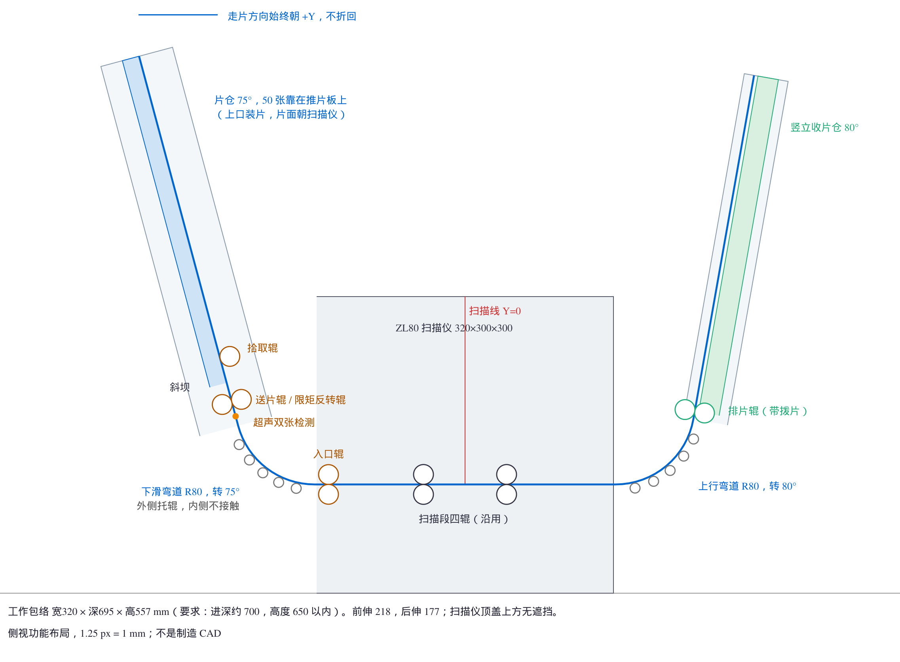

# ZL80 ADF50 V0.4：单向走片、两处大半径弯道，并入 ZL80 本体

修订 ADF50-V0.4-PDR，2026-11-16。初步设计：只有计算和名义外形占位，没有样机和实测，不是制造放行。V0.1、V0.2、V0.3 三个文件夹保持原样。

## 1 结论

- 设计条件（2026-11-16 确认）：进深约 700 mm，高度 650 mm 以内；可以有弯道，但片不能先朝外走再折回。
- V0.4 的走向：片仓在前、向后仰 75° 靠着；片顺坡朝扫描仪下滑，经一段 R80 弯道转平进入扫描仪，扫完从后面出来，经一段 R80 弯道上行，立在后方的收片仓里。全程朝一个方向走。
- 工作包络 320×695×557 mm。五个方案里只有它同时满足进深和高度。
- 扫描仪顶盖上方没有任何东西，开盖维护不受影响。
- 对本体的改动只在前面板：开口装一对入口辊，取代入口迷宫。后面板和出口迷宫不动。

## 2 前两版错在哪里

| 版本 | 问题 |
|---|---|
| V0.2 折回式 | 片仓伸到扫描仪上方，片出仓后先朝外走，再转 115° 折回前面板。走向反复，弯道角度大，片仓压住顶盖。 |
| V0.3 直通式 | 没有弯道，但整机长 995 mm，工位放不下。 |

弯道本身不是问题。合理的弯道应当满足四条，V0.4 按这四条设计：

1. 走向单一：弯道只改变片的俯仰，不让片掉头。
2. 转角小于 90°，半径足够大：两处都是 R80，最厚的 0.35 mm 片弯曲应变 0.22%，远在弹性范围内。
3. 顺着重力：进片是下滑，片自然贴在弯道外侧；外侧用自由转动的托辊，内侧留 3 mm 间隙不接触，乳剂面不贴着导板滑。
4. 弯道前后都有带动力的辊夹持，片不靠远处的辊推过弯。

## 3 架构对比

| 方案 | 包络 宽×深×高 mm | 占地 m² | 弯道 | 单向走片 | 对扫描仪本体的改动 | 满足 700×650 |
|---|---|---|---|---|---|---|
| A　V0.1 外置，片仓 80° | 350×1100×550 | 0.385 | 100° | 否 | 无 | 否 |
| B　V0.2 折回扫描仪上方 | 320×785×639 | 0.251 | 115° | 否 | 无 | 否 |
| C　整机倾斜 60° 直通（粗估） | 320×653×658 | 0.209 | 0 | 是 | 光学核心整体旋转，机架机箱重做 | 否（高度略超） |
| D　V0.3 同平面直通 | 320×995×300 | 0.318 | 0 | 是 | 前后面板开口 | 否 |
| E　V0.4 前斜仓下滑，后竖立收片 | 320×695×557 | 0.222 | 75° + 80° | 是 | 前面板开口装入口辊 | 是 |

C 的尺寸是粗估，高度只超 8 mm，调整角度可以压进去；但它要把光学核心整体转 60°，改动量远大于 E，所以不选。

## 4 V0.4 设计

### 4.1 片的路线

| 位置 | Y mm | Z mm | 说明 |
|---|---|---|---|
| 片仓上口 | −329 | 543 | 从上方装片，片面朝扫描仪 |
| 拾取辊接触点 | −247 | 237 | 压在片堆朝上的一面 |
| 斜坝顶 | −241 | 213 | 整叠片的下缘靠重力落在坝上 |
| 送片辊 / 限矩反转辊 | −236 | 193 | 主分离 |
| 超声双张检测 | −232 | 179 | 紧跟分离辊 |
| 下滑弯道起点 | −229 | 169 | R80，转 75°，弧长 105 mm |
| 下滑弯道终点 | −152 | 110 | 转平，进前面板 |
| 入口辊 | −138 | 110 | 机内，取代入口迷宫 |
| 扫描段入口辊 / 扫描线 / 出口辊 | −42 / 0 / +42 | 110 | 沿用 |
| 上行弯道起点 | +152 | 110 | 出后面板 |
| 上行弯道终点、排片辊 | +231 | 176 | R80，转 80°，弧长 112 mm |
| 收片仓上口 | +292 | 524 | 片竖立，向后仰 10° |

前伸 218 mm，后伸 177 mm。片仓盖板到前面板还有 57 mm 间隙。

### 4.2 片仓和分离

- **靠重力定位。** 片仓后仰 75°，整叠片靠在推片板上，下缘落在斜坝上自动对齐。这解决了 V0.3 平放片堆没有靠齐基准的问题。
- **取朝上的一面。** 拾取辊压在片堆不靠板的那一面，压力由拾取臂弹簧决定，满仓和最后一张相同。
- **推片板保持取片面位置。** 推片板沿法向行程 20.5 mm，由小电机推动、拾取臂位置做反馈，使取片面始终在同一位置，斜坝高度因此恒定。满仓推力约 1–1.9 N。
- **斜坝预分离，辊对主分离。** 坝高 2.5 mm。送片辊和限矩反转辊在坝后 20 mm。
- **双张检测。** 超声对射，在分离辊后 15 mm、弯道之前。

| 片厚 mm | 拾取压力 N | 坝角 ° | 爬坝余量（名义 / 取片面偏差 0.5） | 自重自滑比 | 送片夹持力 N | 限矩窗口 N |
|---|---|---|---|---|---|---|
| 0.15 | 0.5 | 62 | 1.84 / 1.53 | 0.28 | 0.8 | 0.34–0.75 |
| 0.20 | 0.8 | 55 | 2.01 / 1.68 | 0.26 | 1.0 | 0.41–0.96 |
| 0.35 | 1.8 | 38 | 1.77 / 1.47 | 0.18 | 1.5 | 0.61–1.51 |

"自重自滑比"是片自重沿坡分力与爬坝所需推力之比，小于 1 表示不推不会自己滑过坝；三种片厚都在 0.3 以下。

### 4.3 两处弯道

| 片厚 mm | 弯曲应变 | 对外侧托辊的压力 N | 托辊阻力 N | 若改用滑动导板的阻力 N |
|---|---|---|---|---|
| 0.15 | 0.09% | 0.06 | 0.002 | 0.02 |
| 0.20 | 0.13% | 0.13 | 0.004 | 0.04 |
| 0.35 | 0.22% | 0.72 | 0.021 | 0.21 |

- 外侧每处布 5 只自由托辊，内侧导板留 3 mm 间隙。压力是按 4EI/R² 估的量级，不是精确值。
- 送片辊到入口辊沿片 144 mm，入口辊到扫描入口辊 96 mm，两段都有辊夹持带动。
- 扫描过程中拾取臂抬起、反转辊和入口辊脱开，片只由扫描段四辊驱动。此时片上的轴向力来自自重分力和托辊阻力，估算在 −0.11 到 +0.07 N 之间，随片的位置缓慢变化。
- 出口侧扫描时片头由扫描出口辊推上弯道，所需推力最大约 0.03–0.09 N。0.15 mm 薄片 100 mm 自由跨的失稳载荷只有 0.09 N，所以出口到弯道这段必须全程有上下导板。

### 4.4 双张的处理

开始扫描时，片头停在扫描线前 35 mm，此时已有 232 mm（77%）通过了双张检测，剩下 68 mm 在扫描最初阶段继续检测。

- 绝大多数双张是两张一起走，片头就能发现，不会开始扫描。
- 只在尾部 68 mm 才重叠的情况要到扫描中才发现，此时中止并在台账标记重扫。最多损失：快速档 0.1 分钟，标准档 0.6 分钟，高黑度档 1.2 或 4.9 分钟。

V0.3 的"预检往返"取消，片不再倒送。

### 4.5 排片和收片

- 片头在片尾离开扫描出口辊之前已经越过排片辊 93 mm。片尾离开并隔离后，排片辊闭合，以 50 mm/s 把片送进收片仓。
- 收片仓后仰 10°，片竖立靠在后壁上。排片辊同轴带软拨片，把片尾拨到辊上方的挡台上，给下一张让出入口。这个动作没有验证，列为阻断项。
- 收片仓容量按 60 张 0.35 mm 片设计。

### 4.6 走长片

长片不走片仓：卸下前后两个模块（定位销加快卸），恢复 R5 的直通缝手动送片。前面板的入口辊留在机内，脱开时是一条直缝。

### 4.7 节拍（50 张，300 mm 片）

| 扫描档 | 覆盖密度 | 每张 min | 50 张 h | 8 小时张数 |
|---|---|---|---|---|
| 快速 | 约 D 2.5 | 0.69 | 0.58 | 693 |
| 标准 | D 3.5 | 3.03 | 2.52 | 158 |
| 高黑度（PMT 增益 1000，待滨松确认） | D 4.5 | 5.69 | 4.74 | 84 |
| 高黑度（PMT 增益 5000） | D 4.5 | 21.69 | 18.08 | 22 |

## 5 ZL80 本体随之更改的内容

| 编号 | 更改 | 涉及件 |
|---|---|---|
| Z1 | 前面板开口 140×70，装一对可脱开的入口辊；取消入口迷宫 | H02、前侧 H08 |
| Z2 | 后面板、出口迷宫不变 | — |
| Z3 | 取消外置馈片占位和两个手动托盘 | A01、A02 |
| Z4 | 底板前后各加外伸托架和定位销，承片仓模块和收片仓模块 | M01 |
| Z5 | 运动控制增加：拾取/送片电机、推片板电机、脱开机构、排片电机、超声、取片面位置、盖联锁 | B05，或沿用 V0.1 提出的 B10 板 |
| Z6 | 扫描段两只下辊改同步带联动、单电机驱动（沿用 V0.2 的建议） | G3 四辊包 |
| Z7 | 前侧遮光由片仓外壳承担，联锁相应增加 | 机箱 |

外形体放进 R5 整机坐标，按 R5.2 布局 B 与全部实例对查：0 处干涉。最紧的名义间隙：弯道外壳到前后面板各 2 mm，出口弯道到出口迷宫 5 mm，入口辊组到面板内侧 0.5 mm（辊组本来就穿过面板开口）。

## 6 风险和待验证

| 编号 | 风险 | 关闭试验 | 阻断条件 |
|---|---|---|---|
| V4-R01 | 斜坝、限矩窗口、弯道压力都是估算，摩擦系数和弹性模量是假设 | 透明样机，三种片厚，50 / 25 / 1 张 | 未通过不冻结片仓和辊组加工 |
| V4-R02 | 拾取压力和送片夹持划伤乳剂面 | 真实底片两面，斜光显微，扫描前后密度对照 | 0.35 mm 片 1.8 N 配方未通过则不放行厚片 |
| V4-R03 | 竖立收片：拨片能否把片尾拨上挡台，后续片会不会插到前一张后面 | 样机连续收 60 张，三种片厚，含卷曲片 | 未通过则改为后仰更大的收片仓，进深会增加 |
| V4-R04 | 75° 片仓里片堆起拱或下滑，薄片立不住 | 70–80° 试角度，翘曲片 | — |
| V4-R05 | 扫描时片在两处弯道里，轴向力随位置变化影响走片均匀性 | 标定靶测首 / 中 / 尾行距，对比卸下模块的直通状态 | 行距偏差超出主方案门槛则加大弯道半径 |
| V4-R06 | 薄片在出口被推上弯道时失稳 | 0.15 mm 片上行试验，检查导板间隙 | — |
| V4-R07 | 托辊在乳剂面上留压痕 | 托辊材料和直径对比，斜光检查 | — |
| V4-R08 | 尾部 68 mm 的双张要到扫描中才发现 | 统计双张类型分布 | 尾部重叠占比高则加长检测到停片的距离 |
| V4-R09 | 进深 695 mm 只比要求少 5 mm，没有结构余量 | 结构设计后复核 | 超出则把片仓角度调到 78° 左右 |
| V4-R10 | 扫描辊同步带联动的辊径差 | 配磨，标定靶测首 / 中 / 尾 | 不得只凭同速判定 |

## 7 没有做的

- 没有任何样机或实测，力学数字全部来自假设输入。
- 外形体是占位，不是零件；辊组、推片板、脱开机构、拨片没有结构设计。
- 状态机和台账代码（`control/`，V0.1 原样拷贝）没有按 V0.4 流程修改。
- 主方案的 105 页图册、G3 四辊包和 G4 板卡包没有随 Z1–Z7 修改。
- 装片和取片高度在 520–545 mm，是否顺手没有做人机验证。
