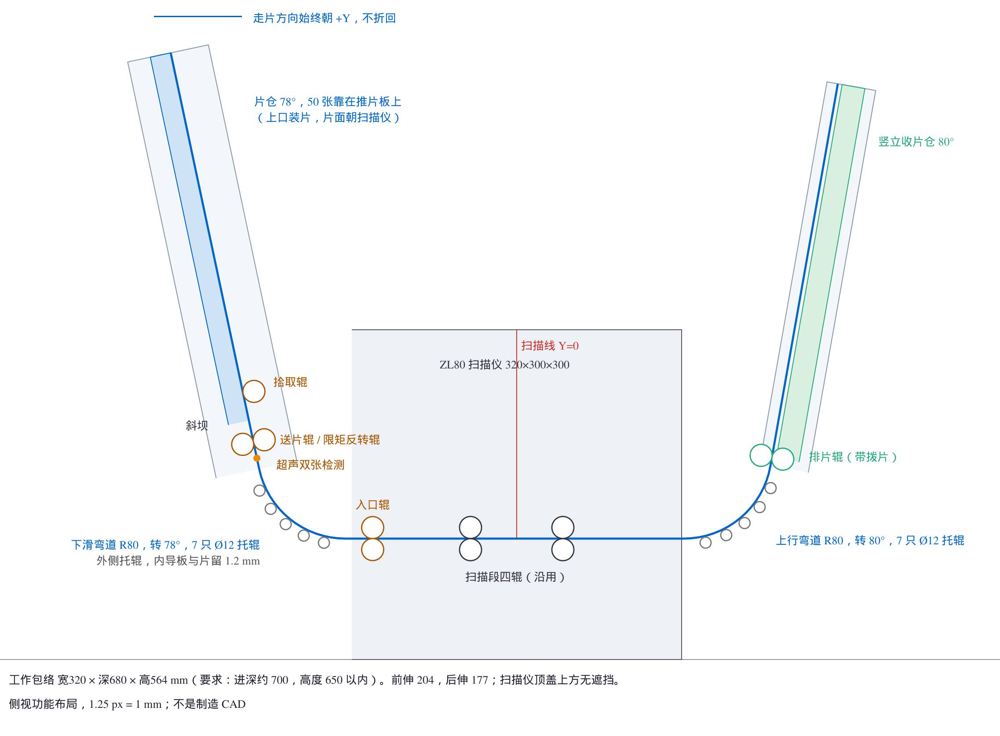

# ZL80 ADF50 V0.6：评估第三方 V05 包并修改设计

修订 ADF50-V0.6-PDR，2026-11-17。评估对象：`ZL80_ADF50_V05_20261117`（第三方对 V0.4 的评审与修订包，文件保持原样）。V0.6 是在 V0.4 基础上采纳、改写或不采纳其建议后的结果。全部是名义几何和解析计算，没有样机、没有实测，不是制造放行。

## 1 结论

- V05 的主要判断成立，其中有 6 条直接指出了 V0.4 的错误，已改正：扫描辊同步带联动与 G3 冲突、出口交接间隙、前面板入口迷宫被取消后没有遮光替代、收片仓止退无效、"远在弹性范围"的结论没有依据、"0 处干涉"没有用 G3 实际文件检查。
- 评估中我自己又查出 V0.4 一处 V05 没提到的错误：模块脚底在 Z=0，而 G3 整机脚底在 Z=−8，片面会差 8 mm。V0.6 改为 13 mm 调平脚，脚底统一到 Z=−8。
- 采纳：前仓 78°、每弯 7 只 Ø12 托辊、内导板间隙 1.2 mm 加可换垫、推片板行程 22 mm、重叠式出口交接、止退指、独立喉口卡匣、整片证据才可复核。
- 不采纳：独立下承架替换扫描仪脚（调平脚已够）；任意速度档（0.625 / 2.5 / 15 mm/s）；174×70 的开口尺寸（卡匣含电机，实际要 184×112）。
- 计量问题的处理与 V05 不同：G3 不改时全 300 mm 片只有 [47, 253] 共 206 mm 有完整计量。V0.6 推荐 ECR-G3-01——在出口压辊上加一只编码器作独立随动测量，单电机牵引和入口随动测量都不动，计量窗口扩到 [0, 300]。已于 2026-11-17 批准。设计见 `ecr_g3_01/ECR_G3_01_出口随动编码器.pdf`：磁编码器装在出口上压辊右轴端，G3 原件只换两颗螺钉。硬件未制造，计量未验证，控制参考默认按双随动运行，但任务仍需系统给出 metrology_qualified。
- 结果：包络 320×680.4×567.4 mm（深度余量 19.6 mm，高度余量 82.6 mm）；86 个件号、154 个实例；自干涉 0 处；与 G3 整机上下文（面板缺口已开）干涉 0 处；65 项测试通过（含 ECR-G3-01 的 8 项）。

## 2 评估范围

做了：

- 读完 V05 的说明、15 条评审发现、11 条变更请求、路径站位和预算表，复算它的关键数值。
- 运行它的 44 项测试和几何预算：全部通过，放行检查仍为 BLOCKED，与它自己的声明一致。
- 用我们的几何重算 78°、435 mm 引带、出口重叠、停车距离、屈曲载荷、零失败置信上界。
- 读 G3 的 README 和实例清单，确认"入口随动测量、出口单电机牵引"和脚底 Z=−8。
- 把 V0.4 机械模型放进 G3 整机上下文（238 个实例）做实体干涉检查，再把 V0.6 做同样检查。

没做：没有打开 V05 的 168 个 STEP、14 张表的工作簿、FreeCAD 宏和询价书，所以它的 CAD 和 xlsx 结论没有核对；它的 B10 板只有接口定义，我也没有评估电路。

## 3 V05 的 15 条发现逐条处理

| 编号 | V05 的判断 | 我的评估 | V0.6 处理 |
|---|---|---|---|
| A01 | 走向保留，前仓 78°，包络 320×682.1×583.2 | 成立。同样改 78°，我的模型深度由 694.6 降到 676.4；V05 的高度含下承架，不可直接比 | 采纳 78°；包络 680.4×567.4（高度自脚底 Z=−8 起算） |
| A02 | R80 应变 0.21875% 不能当作安全结论 | 成立。V0.4 写"远在弹性范围"没有材料数据 | 改为只给应变数字；7 只托辊和可换间隙垫列入试验 |
| A03 | 不能假设两下辊同步带联动，G3 是入口随动测量、出口单牵引 | 成立，已核对 G3 README。V0.2 起我建议的带联动会让入口辊失去独立测量 | 撤回带联动；改提 ECR-G3-01（见第 6 节） |
| A04 | 入口辅助辊要保持到主牵引夹住，不能在 h=−35 就脱开；不许静默裁切 | 成立。V0.4 写停在 −35 后"只靠扫描四辊"，几何上主辊在 +42，够不到 | 控制改为入口辊保持到片头 ≥47 且主辊夹持确认；全长请求在 G3 不改时拒绝 |
| A05 | 尾部双张要到扫描中才发现 | 成立。V0.4 已写，V0.6 数值为未检测尾段 60.1 mm（V05 为 64.1，差在前弯离面板多留了 4 mm 给卡匣法兰） | 晚到双张使该任务无效，RAW 保留并标无效 |
| A06 | 300 mm 片出口重叠量应按路径弧长算 | 成立。V0.4 的"93 mm"是片尾脱离主辊后的量，不是重叠量 | V0.6 排片夹点在弯道末端后 8 mm，重叠 70.3 mm（V05 是 78.3，差在这 8 mm） |
| A07 | 排片辊要在主辊释放前同速接管 | 成立。V0.4 是脱离后再闭合，片头在上行弯道里无夹持支撑 | 压轮在片头越过夹点 5 mm 后闭合并跟随；片尾 ≥+45 且扫描结束才快排 |
| A08 | 薄片弯道：7 只托辊、间隙试验垫 | 成立。7 只 Ø12 使托辊间弦中矢高由 0.51 降到 0.29 mm，辊面间隙 1.6 mm | 采纳；内导板首轮 1.2 mm，另备 0.8 / 2 / 3 mm 对比件 |
| A09 | 软拨片未验证，需止退加独立拨入 | 成立。80° 收片仓里片的下滑力是片重的 0.98 倍，片尾脱离后无止退必然滑回排片夹点（0.35 mm 片下滑力 0.114 N，对壁摩擦约 0.006 N） | 采纳止退指加拨入板；不另设分隔导片，样机证明需要再加 |
| A10 | 不能卸下 ADF 后留着大口；需要独立遮光卡匣 | 成立。V0.4 取消了前迷宫，没有替代 | 采纳卡匣；手动长片模式换装 R5 原迷宫 |
| A11 | 节拍不应绑定密度档位 | 部分成立。我们的档位来自 R5.2 光子预算（行平均加慢走片），不是任意速度；但 G5 确实还没有持续采集 | 保留档位，每条标"计算值，密度能力未验证" |
| A12 | 干涉证据要用 G3/G4 实际文件 | 成立 | 改用 G3 整机上下文检查，面板缺口先开再测 |
| A13 | 斜坝和限矩只是试验起点 | 成立 | 保留为试验起点，表中余量沿用并重算 |
| A14 | 首轮只定义 260–300 mm 片长 | 成立。260 mm 片在我的几何里重叠只有 30.3 mm | 控制拒绝范围外的片长 |
| A15 | 单点超声不等于全宽覆盖 | 成立，但这是试验要求，不改几何 | 记入风险；传感器型号未定（候选的最佳间距 45 mm，我们的通道现为 25 mm） |

V05 的变更请求 E01–E11 中，E01 前仓 78°、E02 G3 不改、E04 托辊、E05 间隙、E06 重叠交接、E09 手动卡匣、E11 整片证据均已采纳；E03 开口按卡匣实际尺寸改为 184×112；E07 采纳一半（见 A09）；E08 独立下承架不采纳；E10 独立 B10 接口板方向同意，本版没有做电路。

## 4 评估中发现的 V0.4 自身错误

| 错误 | 影响 | V0.6 |
|---|---|---|
| 模块脚底 Z=0，G3 脚底 Z=−8 | 模块与扫描仪放在同一平面上时片面差 8 mm | 13 mm 调平脚，行程 ±3，脚底 Z=−8 |
| 建议扫描辊带联动 | 入口辊失去独立测量，辊径差还会拉紧或起拱 | 撤回；ECR-G3-01 |
| 出口先放空再夹 | 片头在上行弯道里无支撑，0.15 mm 片 100 mm 自由跨的失稳载荷约 0.09 N，对所需推力只有约 3 倍裕量 | 重叠接管 |
| 前迷宫取消后无遮光 | 激光和杂散光路径 | 卡匣，但见第 8 节 |
| 止退挡台高度不在片的路径上 | 片尾从挡台上方滑过，起不到止退作用 | 止退指横跨路径 |
| 入口辊组占用 PMT 维护空间 | 维护 PMT 要拆辊组 | 做成可整体抽出的卡匣，写入维护顺序 |
| 干涉检查用 R5 旧实例 | 不含 G3 的 288 mm 底板、1.5 mm 面板、脚 | 改用 G3 上下文 |
| "远在弹性范围" | 无材料依据 | 删除结论 |

## 5 V0.6 的修改

### 5.1 几何和参数

| 项 | V0.4 | V0.6 |
|---|---|---|
| 前仓角 | 75° | 78° |
| 托辊 | 每弯 5 只 Ø10 | 每弯 7 只 Ø12 |
| 内导板间隙 | 3 mm | 1.2 mm，可换 0.8 / 2 / 3 mm |
| 推片板行程 | 20.5 mm（臂长 26） | 22 mm（臂长 28，曲柄 6.2°–63.2°） |
| 前弯弧长 | 104.7 mm | 108.9 mm |
| 入口辊位置 | Y=−138 | Y=−131（给光陷阱段让出 9 mm） |
| 前弯离面板 | 2 mm | 6 mm（卡匣法兰 3 mm） |
| 未检测尾段 | 68.3 mm | 60.1 mm |
| 包络 | 320×694.6×557.2 | 320×680.4×567.4 |
| 脚底高度 | Z=0 | Z=−8 |

### 5.2 机械件变化

新增：喉口卡匣法兰 EN12、光陷阱板 EN13、侧挡板 EN14、侧密封块 EN15；止退指轴 XB20、止退指 XB21（3 只）、拨入轴 XB22、拨入板 XB23（2 只）；内导板对比件 AF31_0.8 / _2 / _3。取消：片尾挡台 XB04、软拨片轮 XB07。改动：侧板外形、托辊和销、导板半径、顶升臂、推片板、调平脚、前底板与舌板位置、入口辊组整体后移。外购件新增限矩联轴器、止退指扭簧。

86 个件号，其中自制 78 个；154 个装配实例。自制件质量（不含电机和紧固件）：片仓模块 3.43 kg，喉口卡匣 0.48 kg，收片模块 2.06 kg。

### 5.3 喉口卡匣

- 卡匣由法兰、上下光陷阱板、两块侧挡板、侧密封块和入口辊组构成，整体从前面板外侧抽出。
- 面板开口 x −72…112、z 54…166（184×112），法兰压在面板外侧，带密封垫。
- 手动长片模式换装 R5 原迷宫（H08），与 ADF 卡匣互斥，靠到位和锁紧传感器联锁。
- 光陷阱板只有 9 mm 长，R5 原迷宫是 30 mm。**两者等价没有证明**，是第 8 节的 P0 项。
- 入口辊组仍落在扫描仪预留的 PMT / 前端维护空间里，所以维护 PMT 前要先抽出卡匣，在维护说明里写明。

### 5.4 出口：重叠交接与止退

- 压轮在片头越过排片夹点 5 mm 后闭合，跟随扫描速度，由限矩联轴器避免拉扯。
- 片尾到 s=+45、主辊尾部清空、扫描结束确认后，才以 50 mm/s 快排。
- 片尾离开排片夹点后，三只被动止退指（指尖向下坡，上行时被顶开、片尾落回时托住）托住片尾，拨入板再把片推向片堆。拨入板转角 40°。这套动作没有验证。

## 6 交接与计量

| 项 | 数值 |
|---|---|
| 排片夹点路径位置 | s=271.7 mm（扫描线为 0） |
| 主牵引到排片夹点 | 229.7 mm |
| 300 mm 片重叠量 | 70.3 mm |
| 260 mm 片重叠量 | 30.3 mm |
| 跟随触发时（片尾 s=+12）排片夹入深度 | 40.3 mm，主辊剩余夹持 30 mm |
| 入口辊离开片尾时片头位置 | 169 mm |
| 停车距离（50 mm/s、70 ms、200 mm/s²、2 mm） | 11.75 mm |

计量窗口（300 mm 片，前后各留 5 mm 夹持余量）：

| 方案 | 有完整计量的区段 | 说明 |
|---|---|---|
| G3 不改（批准前的状态） | [47, 253]，206 mm | 头 47 mm 靠入口辊推送，只有入口随动测量；尾 42 mm 只有主辊编码器推算 |
| ECR-G3-01（已批准）：出口压辊加编码器 | [0, 300] | 头部由入口随动测量，尾部由出口随动测量，中段两者互相校核；单电机牵引不变 |
| 60+300+60 mm 引带 | [0, 300] | 要 435 mm 片仓：78° 时高度 666.9 mm、深度 698.2 mm，超出 650 mm 高度限制 |

控制参考模型（`control/adf_controller.py`）默认按双随动运行，允许 [0, 300]，互相校核重叠区内两只随动不一致时锁存 `FOLLOWER_MISMATCH`；按 G3 不改（`dual_follower=False`）运行时仍拒绝窗口外的 ROI，不静默裁切。

## 7 检查结果

| 项 | 结果 |
|---|---|
| 件号 / 实例 | 86 / 154，全部为有效实体 |
| 自干涉 | 0 处（检查 246 对相邻件） |
| 与 G3 整机上下文干涉 | 0 处（检查 7 对；G3 前面板开 184×112 口、前后面板下沿各开 62×7 缺口后） |
| 与 PMT 维护空间 | 仅喉口卡匣（可抽出）占用 |
| 方案计算测试 | 22 项通过 |
| 机械模型测试 | 14 项通过 |
| 控制参考测试 | 21 项通过 |
| ECR-G3-01 测试 | 8 项通过；与 G3 整机上下文 0 处干涉（上辊名义、上抬 5 mm、下沉 1 mm） |

以上只覆盖静止名义位姿。没有做运动扫掠、线缆、公差、强度和倾覆。

## 8 对扫描仪本体的改动

| 编号 | 改动 | 状态 |
|---|---|---|
| Z1 | 前面板 G3-H01 开 184×112 口，装喉口卡匣；取消入口迷宫 | 需确认 1.5 mm 薄板开口后的刚度 |
| Z2 | 前、后面板下沿各开 62×7 缺口让舌板通过 | — |
| Z3 | 底板 G3-M01 前后缘各加 2×M5 螺孔和 2×φ6 销孔 | — |
| Z4 | 取消外置馈片占位 A01 和手动托盘 A02 | — |
| Z5 | 扫描段不改（撤回带联动）；ECR-G3-01 在出口上压辊右轴端加磁编码器，G3 原件只换两颗螺钉 | 已批准，硬件未制造 |
| Z6 | 前侧遮光由卡匣承担，联锁增加；手动模式换原迷宫 | 光陷阱等价性未证明 |
| Z7 | 运动控制增加：拾取/送片、推片板、脱开、排片、止退拨入、超声、位置传感器、盖和卡匣联锁 | 板卡未设计 |

## 9 风险和待验证

在 V0.4 风险表基础上新增或改变的项：

| 编号 | 风险 | 关闭试验 | 阻断条件 |
|---|---|---|---|
| V6-R01 | 喉口光陷阱只有 9 mm，漏光和杂散光未证明 | 盖合、卡匣抽出、手动卡匣三种状态测暗电平和漏光 | 激光安全评估前不得上电 |
| V6-R02 | 面板开口 184×112 使 1.5 mm 薄板刚度下降 | 刚度计算或样板测试 | 不通过则加框 |
| V6-R03 | 重叠接管时两台电机拉扯片 | 编码器和张力试验，限矩联轴器整定 | 未通过则回到脱离后再夹，并重估薄片支撑 |
| V6-R04 | 止退指和拨入板能否把片堆齐 | 样机连续收 60 张，三种片厚，含卷曲 | 同 V4-R03 |
| V6-R05 | ECR-G3-01 已批准但硬件未装、计量未验证 | ECR 文件中的 T1–T6 | 验证前不得声明全长计量能力 |
| V6-R06 | 1.2 mm 间隙下导板接触乳剂面 | 0.8 / 1.2 / 2 / 3 mm 对比，斜光检查 | — |
| V6-R07 | 超声传感器选型：候选最佳间距 45 mm，通道现为 25 mm | 选型后调整通道或改传感器 | — |
| V6-R08 | 单点超声不能证明全宽叠片检出 | 前端、中段、末端错位和边角小面积叠片的挑战样本 | — |
| V6-R09 | 调平脚行程 ±3 mm 是否够台面平整度 | 实测台面 | — |

可靠性表述：50 次零失败的单侧 95% 上界约 5.82%，不能写成"漏检率低于 0.1%"；达到 0.1% 至少需要 2995 次零失败的独立试验。

## 10 没有做的

- 没有任何样机或实测；力学数字都来自假设。
- V05 的 CAD、工作簿、B10 方案没有核对。
- 没有做公差、紧固件、强度、倾覆、运动扫掠和线缆。
- 扫描仪本体的 G3、G4、原图册没有修改。
- 控制参考模型只产生意图，不驱动硬件，不使能激光，没有 HIL。
- 主方案的 R5.2 融合文档、决策表和清单已同步指向 V0.6。
