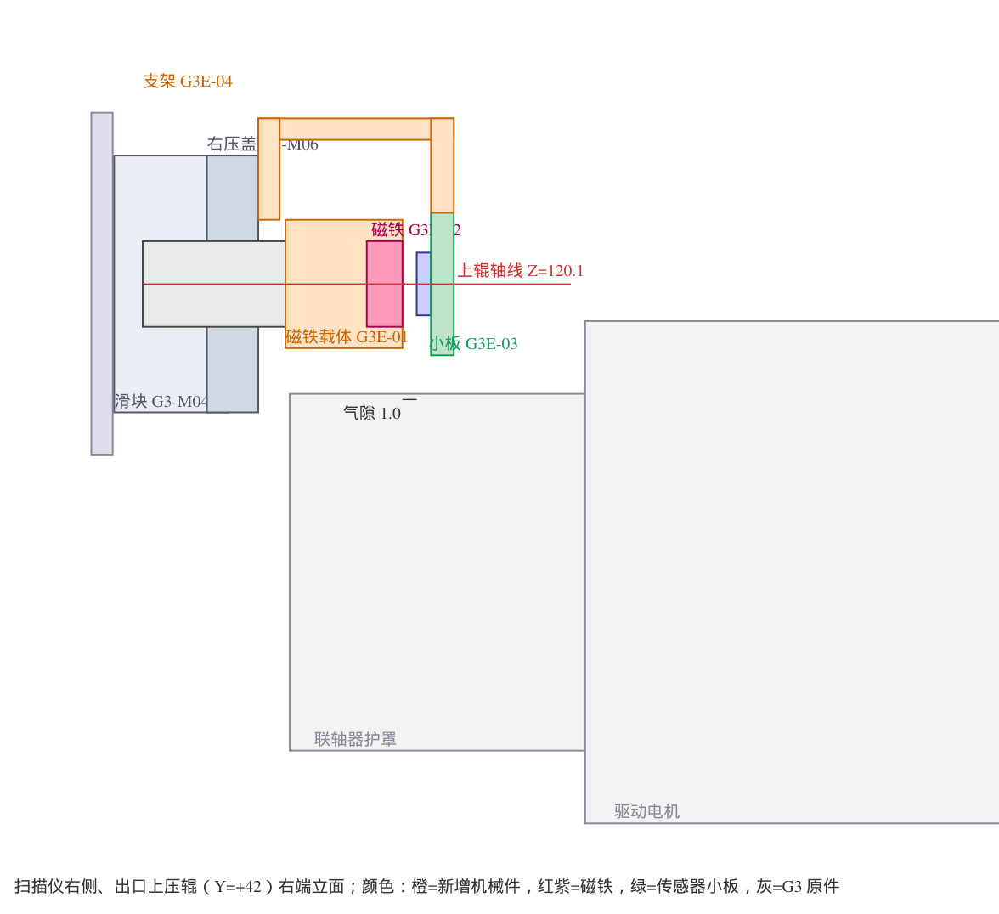
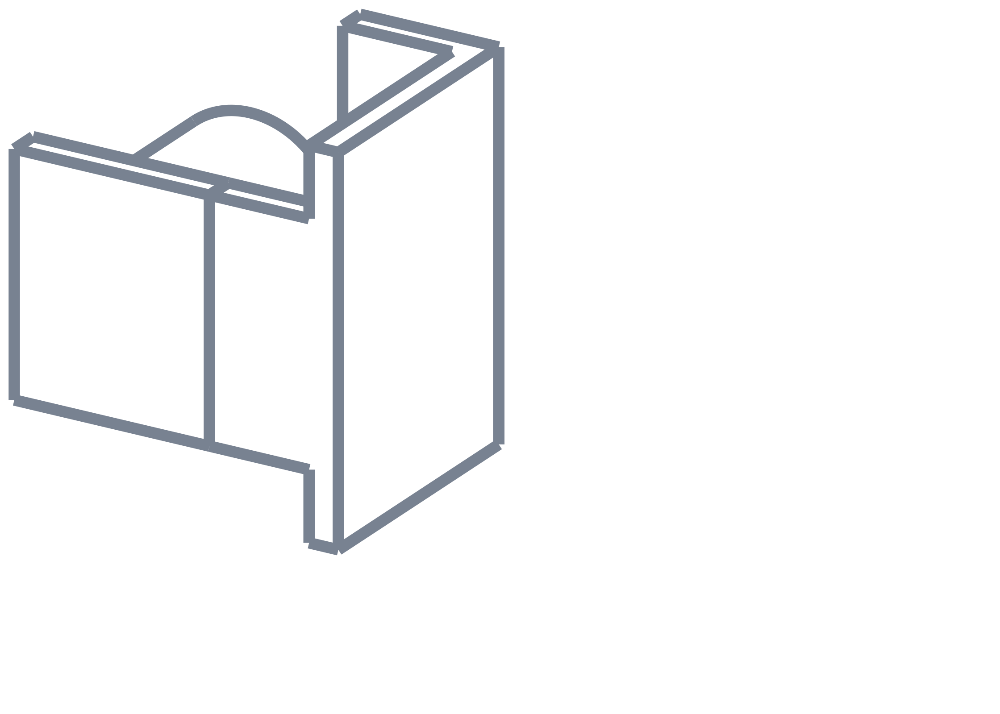

# ECR-G3-01：出口压辊加独立随动编码器

2026-11-17，用户批准。状态：设计已完成，硬件未制造，计量能力未验证。G3 包的文件没有改动，本 ECR 作为变更登记和附加设计放在 `ZL80_ADF50_V06/ecr_g3_01`。

## 1 目的

G3 的结构是入口下辊随动测量（Y=−42，带编码器）加出口下辊单电机牵引（Y=+42，带编码器）。300 mm 片只有 [47, 253] 共 206 mm 同时被两组辊夹住并有完整计量：头 47 mm 靠入口侧推送，尾 42 mm 只有主辊编码器推算。

本 ECR 在出口上压辊（从动、弹簧压紧）上加一只编码器，让它独立随动测量。头部由入口随动测量，尾部由出口随动测量，中段两者互相校核，计量窗口扩到 [0, L]。单电机牵引、入口随动测量和弹簧压紧都不动，不采用此前提出的带联动。

## 2 设计

| 件号 | 名称 | 材料 | 质量 g | 说明 |
|---|---|---|---|---|
| G3E-01 | 磁铁载体套 Ø9×8.2 | 6061-T6 | 0.9 | Ø6 内孔套在上辊右轴端（G3-R03 的右端是 Ø6），粘接加顶丝；端面有 Ø6.1×2.5 磁铁槽 |
| G3E-02 | 径向充磁磁铁 Ø6×2.5 | 外购 | 0.5 | 压入载体槽 |
| G3E-03 | 磁编码器小板 12×10 | 外购 | 1.5（假设） | ABI 输出；候选 AS5047P 类，手册指标待核对；气隙 1.0 mm |
| G3E-04 | 支架 | 5052-H32 | 1.5 | Z 形，两耳套在右上压盖的两颗螺钉下，随上辊升降 |

- **G3 原件改动**：只有 G3-M06 右上压盖外侧的两颗螺钉（G3-F01）换成长 1.5 mm 的同规格螺钉。上辊芯 G3-R03 不加工，载体直接套在轴端。
- **为什么放在右端**：左端有出口下辊的编码器安装板（G3-M14，x −91.5…−88.5，覆盖 z 到 122.9），上辊轴线 z=120.1 正好穿过，放不下。右端轴端 Ø6，伸出压盖 6 mm，护罩顶面 z=112.4，板底 z=115.1，有空间。
- **为什么用磁编码器**：同样 AMT112S 的体积和质量放不进右端空间，也会明显增加上辊的活动质量。磁编码器只增加约 4.4 g。
- **随上辊升降**：支架和小板跟着上压辊走，上抬 5 mm（释放）、下沉 1 mm 时相对位置不变，磁铁和芯片的气隙由支架决定。

## 3 计量覆盖

| 片长 mm | 入口随动有效 | 出口随动有效 | 合并 | 互相校核重叠 | G3 不改的窗口 |
|---|---|---|---|---|---|
| 260 | 0–213 | 47–260 | 0–260 | 166 mm | 47–213 |
| 280 | 0–233 | 47–280 | 0–280 | 186 mm | 47–233 |
| 300 | 0–253 | 47–300 | 0–300 | 206 mm | 47–253 |

"有效"含前后各 5 mm 夹持余量。入口随动在片尾离开入口夹点前有效，出口随动在片头被出口夹点夹住后有效。头 47 mm 内主辊尚未夹持，片靠喉口卡匣的入口辊推送，入口随动编码器测量；出口随动编码器只在片头越过 47 mm 之后才参与。

## 4 精度和载荷

| 项 | 数值 |
|---|---|
| 分辨率 | 14 位（16384 /转）时 Ø20 辊周每计数 3.835 µm，约占 50 µm 像素的 7.7 %；与 G3 的 4096 PPR×4 相同 |
| 精度预算 | 保持 G3 编码器的 0.2°，相当于辊周 34.9 µm；候选芯片手册精度没有核对，不引用 |
| 计数率 | 15 mm/s 时约 3 900 /s；0.234 mm/s 时约 61 /s，低速要靠平均 |
| 上辊增加的活动质量 | 4.4 g，约为 G3 假设值 200 g 的 2.2 % |
| 压紧力变化 | 约 +0.04 N，占 6.06 N 的 0.7 % |
| 互相校核限值 | 暂取 0.05 mm，台架按两只随动的实测散差整定 |

## 5 接口

- **电气**：一路 ABI 编码器（5 V CMOS，与 G3 的编码器一致）加电源。随上辊升降 5 mm，必须用带服务环的 FFC，不能用硬线。
- **B05**：G4 的 B05 编码器输入没有闭合；需要核对现有输入路数，不够就加一路。本包没有设计电路。
- **数据**：主机事件侧车同时记录两只随动编码器和校核结果；G5 的 RAW 协议不改。
- **控制**：状态机参考模型默认按双随动运行，新增输入 `follower_agree`，在互相校核重叠区内为假则锁存 `FOLLOWER_MISMATCH`，该任务无效；任务仍需系统给出 `metrology_qualified`，硬件没有装好、没有标定前不会允许扫描。

## 6 检查结果

| 项 | 结果 |
|---|---|
| 与 G3 整机上下文干涉（238 个实例） | 上辊在名义位置、上抬 5 mm、下沉 1 mm 三个高度均为 0 处 |
| 最小间隙 | 小板到联轴器护罩 2.7 mm（下沉 1 mm 时 1.7 mm），载体到护罩 3.2 mm，支架到滑块和右机架 2.1 mm |
| 载体与磁铁气隙 | 1.0 mm |

只覆盖静止名义位姿；公差、紧固件、FFC 路径没有建模。

## 7 验证试验

| 试验 | 内容 |
|---|---|
| T1 | 标定靶过两只随动，测偏移和散差，整定互相校核限值 |
| T2 | 0.15–0.35 mm 片通过时上压辊相对下辊的滑移，含新、老化辊 |
| T3 | 加装后实测压紧力，对照 6.06 N 的计算值 |
| T4 | 驱动电机漏磁对磁编码器的影响（距离约 9 mm），电机运转和停止对比 |
| T5 | FFC 往复 5 mm 的寿命 |
| T6 | 与无 ADF 直通基准对比首、中、尾的行距、条纹和密度 |

## 8 风险

| 编号 | 风险 | 处理 |
|---|---|---|
| E1 | 驱动电机漏磁干扰磁编码器 | T4；必要时加屏蔽或改光学小编码器 |
| E2 | 上辊靠摩擦转动，薄片可能打滑，测量失真 | T2；打滑时互相校核会报警 |
| E3 | 载体与 Ø6 轴端的配合、同轴度和气隙公差没有核算 | 公差链，芯片中心对轴 ±0.25 mm |
| E4 | 两辊有效滚动半径不同 | 标定靶整定比例系数，不得假设等于名义值 |
| E5 | 候选传感器的精度和输出类型未核对 | 选型时核对数据手册 |
| E6 | 支架让上辊活动质量增加 4.4 g | T3 |

## 9 没有做的

- 没有样机，没有任何实测。
- 传感器型号未选定，小板是占位。
- 没有公差链、紧固件、线缆和 B05 电路。
- G3 包的文件、图册和 BOM 没有修改，变更登记见 `ECR_G3_01_变更登记.csv`。
