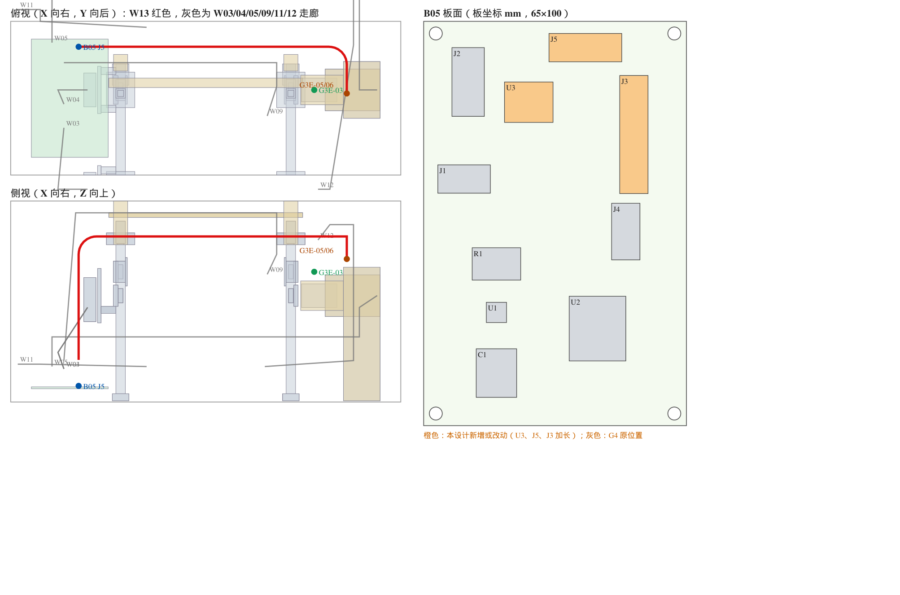

# ECR-G3-01 配套：B05 第三路编码器输入和线束 W13

2026-11-17。状态：设计完成，硬件未制造，无实测。G3、G4、G5 包的文件没有改动，需要它们改的地方列在第 6 节。

## 1 查到的现状

- B05 的 U2 是 2 片 SN74LVC3G17，共 6 路，正好用于 M（测量）和 D（驱动）两组 ABZ。第三路没有缓冲器。
- B05 的 J2 只有 M、D 两个编码器输入口。
- B05 的 J3（到 FPGA 板）只有一组 ENC_A/B/Z，而 FPGA 板 J5 需要 ENC_M 和 ENC_D 两组。这是 G4 原来就有的缺口，本设计扩 J3 时一并补上。
- G5 原包的 FPGA 板 J5_V1.3B 第 7–34 脚已全部分配，第 1–6 脚没有说明。后来确定 FPGA 板是 Hello-FPGA 核心板，G5 已按它另出修订包（见第 6 节），第三路有了候选引脚。

## 2 B05 输入电路

| 项 | 设计 |
|---|---|
| 缓冲器 U3 | 第 3 片 SN74LVC3G17，3 路：A、B、OPEN。与 U2 同型号，手册指标（5V 输入容限等）待核对 |
| A、B 输入网络 | 串 470 Ω，对地 470 pF，47 kΩ 下拉。5V 高电平在缓冲器输入点约 4.95 V，传感器负载约 0.1 mA |
| OPEN 线 | 传感器板上焊 0 Ω 接地；B05 上拉 10 kΩ 到 3V3。线缆或 FFC 断开时为高，插好为低 |
| 5V_E 供电 | 铁氧体磁珠 + 4.7 µF + 100 nF；5V 单向 TVS 阵列 1 片。短路保护随 G4 电源方案闭合 |
| 新增连接器 J5 | 1×6 2.54 mm：1 5V、2 GND、3 A、4 B、5 OPEN、6 屏蔽 |
| J3 | 2×6 改 2×10：补全 M、D、E 三组和回流地，见 `ECR_G3_01_E_B05_J3引脚.csv` |
| 板面 | U3 区域中心 (26,80)，J5 中心 (40,93.5)，J3 中心 (52,72)；新旧器件最小间距 2.4 mm，边缘 3 mm 和孔位 4.5 mm 禁区都满足（矩形近似） |

时间裕量（A、B 每个状态的持续时间对比滤波延迟，滤波时间常数 0.29 µs）：

| 速度 | 计数率 /s | 每状态时间 µs | 滤波延迟占比 | 延迟造成的位置偏移 µm |
|---|---|---|---|---|
| 0.234 mm/s | 61 | 16 389 | 0.001 % | 0 |
| 15 mm/s | 3 911 | 255.7 | 0.08 % | 0.003 |
| 50 mm/s | 13 038 | 76.7 | 0.26 % | 0.010 |

滤波对速度和位置的影响可以忽略，所以抗噪声可以取得较保守。传感器输出内阻按 100 Ω、线缆电容按 100 pF/m 估计，都是假设。

低速静止时磁编码器可能在一个计数边界来回跳，解码器会记成 ±1 计数的抖动（3.8 µm）。传感器的滞回要在选型时看手册，台架上测。

## 3 FFC 和圆线

分两段：传感器随上辊动，所以用 FFC；固定端转接板后换圆线。

| 段 | 内容 |
|---|---|
| FFC | 6P 0.5 mm，0.3 mm 厚，4.5 mm 宽，长 27 mm。脚序：1 5V、2 GND、3 A、4 B、5 OPEN、6 GND |
| 传感器端 | G3E-08 竖直进线连接器，焊在 G3E-03 的 +x 面，位置 x 91.8–93.4、z 121.3–123.9 |
| 固定端 | G3E-05 L 形支架贴在电机支架 G3-M12 顶面，上面是 G3E-06 转接板，连接器位置 x=117、z=127.8 |
| 姿态 | 水平拉出，预成形向上拱，拱高 5.0–5.6 mm，半径 15–18 mm（上辊 −1…+5 mm） |
| 圆线 W13 | 5 芯屏蔽 AWG30，外径 4 mm，最小弯曲半径取 W03/W04 的 15 mm |

走线：转接板 (119.3, 39, 131) → 垂直上到 z=150 → 向后到 y=78.5 → 向左到 x=−107.5 → 垂直下到 B05 J5 上方 12 mm。中心线长 370 mm（含 R15 圆角），下料 440 mm（两端各 20 mm，服务量 30 mm）。三个直角圆角允许的最大半径 19–104 mm，R15 能放下。

走这条路的原因：传感器在右机架外侧，要绕过右机架和上方的预压板（TOP_72_42，z 143–153、调节螺钉到 z 163）；从后方 y=78.5、z=150 横穿，下面是 B04 板，上面是光学立柱（间隙 4.5 mm）。放在 W09（同步线）之外，不与它平行。

| 与已有线束的表面间隙 mm | W05 电机 | W09 同步 | W11 24V | W12 释放互锁 | W04 | W10 |
|---|---|---|---|---|---|---|
| W13 | 18.4 | 10.5 | 15.1 | 6.1 | 32.5 | 37.0 |

W09 是硬件时间戳线，所以要求至少 10 mm，当前 10.5 mm 刚够；W12 是低频常闭回路，6.1 mm 可接受。

## 4 检查结果

| 项 | 结果 |
|---|---|
| FFC、连接器、支架、转接板与 G3 整机上下文（238 个实例）干涉 | 上辊名义、上抬 5 mm、下沉 1 mm 三个高度均为 0 处 |
| 与已批准的 ECR 件的最小间隙 | 连接器到支架 1.2 mm；FFC 到小板 1.5 mm、到支架 2.6 mm |
| 支架和电机支架 | 贴合（间隙 0），这是设计意图 |
| FFC 力 | 按悬臂估算，刚度 0.044 N/mm（E=5 GPa 为假设）；膜厚 0.35 mm 的动作约 0.015 N，占预压 6.06 N 的 0.25 %；释放 5 mm 约 0.22 N |
| 上辊增加的活动质量 | 又增加 0.18 g，合计 4.62 g |
| 5V 压降 | 约 10 mV（传感器电流按 30 mA 假设） |

## 5 开放问题

- **FPGA 引脚**：核心板上已有候选（见第 6 节），但底板没有确认，B05 的 J3 到底板的接线对应关系还要重新核对。
- **竖直进线 FFC 连接器**：没有选型，也没确认有 4.5 mm 宽、0.5 mm 脚距的合适件。
- **FFC 方向**：预成形的拱向上，要靠 PET 加强保持，向下鼓会碰电机顶面（z 117.5）。
- **电机漏磁与相线**：FFC 离电机顶面约 5 mm，线束离相线通道约 18 mm，T4 要在这个位置测。
- **固定端粘贴**：G3E-05 用 VHB 粘贴还是 M3 螺钉。打孔等于改 G3-M12，需要追加批准。
- **U3 手册**：SN74LVC3G17 的输入容限、阈值要核对；不确认则 A、B 路改用电阻分压。
- **FFC 疲劳**：释放动作 5 mm 的寿命没有数据，T5 要覆盖。
- 所有数值是名义几何和假设值，没有样机。

## 6 需要 G4、G5 配合的改动

| 编号 | 内容 | 优先级 |
|---|---|---|
| G5-E1 | 已在 `ZL80_R52_G5_HF_20261117` 分配：ENC_E_A=D18、ENC_E_B=E17、ENC_E_OPEN=D20（核心板 Bank35，3.3 V）。底板未确认，候选未批准，不用让出 Z | P0 |
| G5-E2/E3 | 已改：capture_core 增加 enc_e 端口和第三个解码器，新增记录类型 0x22；只做了 slang 编译检查，未仿真 | P0 |
| G5-E4–E6 | 已改：故障位 9/10、host 的 follower_agree、tb_encoder_e；testbench 未运行 | P1 |
| G4 | B05 原理图增加 U3、J5，J3 改 2×10；ENC_A/B/Z 解释为测量组，需 G4 确认 | P0 |

详见 `ECR_G3_01_E_G5接口变更.csv` 和 `ECR_G3_01_E_B05变更清单.csv`。

## 7 没有做的

- 没有改 G3、G4 的任何文件，原理图、PCB 都没动；G5 另出了修订包，原包不变。
- 没有 U3 的原理图和布线，没有 ERC。
- 没有接插件型号、压接图、线束实物扫掠。
- 圆线只做了中心线圆角和 AABB 间隙，没有整束干涉。
- 没有任何实测。
